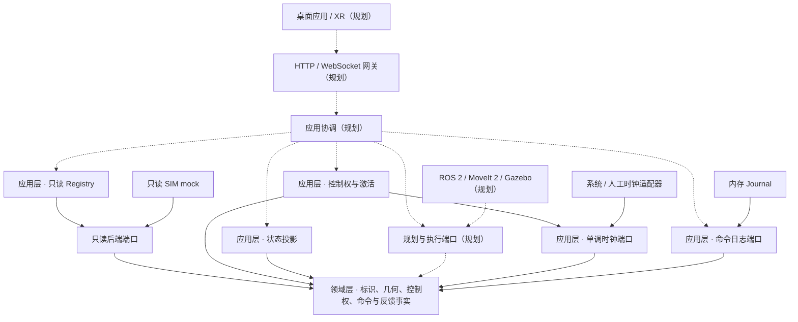

# Bot3D

**面向机器人仿真、真机与 XR 交互的任务协调框架。** Bot3D 以机器人能力、任务目标和状态反馈为应用接口，目标是让同一套任务流程可以在不同后端上复用。设备之间的差异由适配器、机器人模型、配置和标定处理。

[技术架构](#技术架构) · [实现方式](#实现方式) · [快速上手](#快速上手) · [开发路线](#开发路线) · [文档入口](docs/README.md)

## 项目目标

以固定基座机械臂为例，桌面应用和 XR 前端可以用同一个目标表达「让工具到达指定坐标系下的位姿」。切换到另一后端时，应用保留相同的任务逻辑，框架根据当前绑定的设备、模型和场景重新检查能力并规划。前端分别显示目标、计划和后端反馈，让操作者看清机器人实际到达的位置。

- **按能力表达任务。** 末端位姿、夹爪等能力有各自的参数、约束和可用条件。上层可以据此选择可执行的任务，并读到能力不可用的原因。
- **显式选择仿真或真机。** 每台逻辑机器人绑定一个执行后端，应用能看到当前是 SIM 还是 REAL，以及对应的设备身份。执行和反馈都归属该绑定。
- **让设备接入集中在边界。** 内核使用普通 Python 值与端口，适配层负责映射 ROS 消息、厂商接口、引擎坐标和单位。

首条验证路径选用单机械臂的离散末端位姿任务，覆盖目标预览、规划、执行反馈和停止。[项目范围与设计原则](docs/design/01-principles-and-scope.md)

## 技术架构

Bot3D 采用分层设计。Python 内核保存跨后端通用的领域语义，规划中的模块化单体协调会话、控制权和命令生命周期，外部适配器连接规划器、仿真器和设备。电机闭环由设备侧驱动和控制器处理。



实线连接现有模块，虚线表示规划中的依赖。各层通过领域值和端口交互，适配器依赖内核。首条集成路径优先考虑 ROS 2、MoveIt 2 和 Gazebo，XR 前端候选为 Unity + OpenXR。[完整架构、组件职责与数据路径](docs/design/02-system-architecture.md)

### 末端目标如何执行

1. **预览与提交。** 前端将输入转成指定坐标系下的工具位姿，经确认后提交任务，携带设备绑定和场景版本。
2. **检查与规划。** 协调层检查能力、控制权和上下文，规划器按当前模型与场景生成轨迹。
3. **下发与反馈。** 协调层复核执行前提并经唯一执行路径下发。后端报告实际状态，前端据此更新显示。

这是首条集成路径的设计流程。MoveIt 2 负责规划，执行适配器负责下发轨迹。[命令、状态与适配器契约](docs/design/03-contracts-and-adapters.md)

## 实现方式

当前仓库提供可从源码安装的 Python 内核。运行只用标准库，构建和测试的开发依赖分别由项目元数据和锁文件固定。

| 模块 | 当前实现 |
| --- | --- |
| `framework.domain` | 不可变标识、SI 值、坐标数学、位姿目标与单调时刻；能力 / 身份、控制租约与激活策略；命令规范摘要、日志事实，以及带来源 / 时间 / 质量的反馈快照。 |
| `framework.application` | `RobotRegistry` 提供只读发现和状态查询；`ControlAuthority` 管理会话租约、显式激活与失权；`StateProjection` 分开目标、计划和实际反馈，维护新鲜度与静止证据；端口提供后端读操作、单调时钟与 `JournalPort`。 |
| `framework.adapters` | 系统 / 人工时钟、静态只读 SIM mock，以及实例内原子写入的 `InMemoryJournal`，供独立测试与应用接入验证使用。 |

位姿目标以米表示位置，方向采用右手主动旋转与 `xyzw` 四元数。变换带源坐标系和目标坐标系，组合变换或转换目标时会检查坐标系是否匹配。数值构造拒绝非有限分量，单位换算在边界显式进行。[基础类型与坐标数学](docs/design/07-domain-types-and-geometry.md)

有效能力由规划、模型、坐标、策略和执行支持共同计算。只读 Registry 始终保留缺少执行支持的原因；重复查询保持能力版本，配置、模式或可用性语义变化时递增。机器人与设备身份分开，多个只读镜像可以共享一个设备。[只读 Registry 与能力模型](docs/design/08-readonly-registry-and-capabilities.md)

控制权由独立的内存管理器维护。同一设备最多配置一个可写绑定，只有已登记授权的会话能取得租约；取得租约后，还须明确确认并通过状态、标定、本地保护和停车前提，才能进入 `ARMED`。租约到期、会话失联或连续前提失效会撤权，结果保留原绑定的失权事件，供后续停止用例处理。能力上下文变化会退役旧绑定；执行影响不确定时锁住后续控制，处置后重新申请并激活。[控制权、激活与恢复边界](docs/design/09-control-authority-and-activation.md)

命令以机器人和命令 UUID 为键，版本化摘要包含目标、约束、后端代次、租约、能力版本、上下文和期限；请求关联号不影响摘要。同键同摘要重试返回原记录，异摘要明确冲突。日志保存原绑定、下发意图、句柄、事件和终态，追加事实保留旧快照；内存适配器在存储结果未知后锁住新写入。记录候选与公开 `ACCEPTED` 分开，运动许可及最终下发由后续协调层裁决。当前记录只保留在实例生命周期内。[命令摘要与内存 Journal](docs/design/10-command-journal-and-idempotency.md)

状态投影接收绑定明确的反馈，分别保留关节、工具位姿和控制器状态的来源、质量及失效原因。源采样年龄与已采纳包的接收年龄独立计算；重复包只更新传输接收信息，不延长实际数据的有效期。源钟通过显式偏移 / 不确定度映射到保护钟，未知值保持 `None`。`STOPPED` 需要新鲜可信的控制器与关节反馈覆盖完整静止窗口；FK 位姿始终标为 `DERIVED`，沿用原关节采样时间。目标和计划的更新不会写入实际反馈。[状态投影、时间质量与静止证据](docs/design/11-state-projection.md)

## 快速上手

使用 **CPython 3.12.11** 和 **uv 0.10.9**。分发名称为 `bot3d-kernel`，Python 导入名称为 `framework`。

```bash
git clone https://github.com/UyNewNas/Bot3D.git
cd Bot3D
uv sync --locked --no-editable --reinstall-package bot3d-kernel --link-mode copy --default-index https://pypi.org/simple
```

同步命令将构建出的包安装到项目虚拟环境。修改源码后，重新同步即可刷新安装包。[环境与构建细节](docs/design/06-python-foundation.md)

### 将末端目标从基座坐标系转换到世界坐标系

以下例子将工具目标设在基座 X 轴方向的 250 mm 处。基座相对世界坐标系绕 Z 轴旋转 90°，原点在世界坐标 `(1, 2, 3)` 米处。

```python
from math import sqrt

from framework.domain.geometry import Quaternion, RigidTransform
from framework.domain.targets import PoseGoal
from framework.domain.values import FrameId, RobotId, ToolId, Vector3, mm_to_m

base = FrameId("arm-fixture/base")
world = FrameId("cell/world")
goal = PoseGoal(
    robot_id=RobotId("arm-fixture"),
    frame_id=base,
    tool_id=ToolId("tool0"),
    position_m=Vector3(mm_to_m(250), 0, 0),
    orientation_xyzw=Quaternion(0, 0, 0, 1),
)

sqrt_half = sqrt(0.5)
world_from_base = RigidTransform(
    target_frame=world,
    source_frame=base,
    translation_m=Vector3(1, 2, 3),
    rotation=Quaternion(0, 0, sqrt_half, sqrt_half),
)

world_goal = goal.transformed(world_from_base)
x, y, z = world_goal.position_m.as_tuple()
print(f"{world_goal.frame_id.value}: ({x:.2f}, {y:.2f}, {z:.2f}) m")
# cell/world: (1.00, 2.25, 3.00) m
```

将示例保存为 `pose_example.py`，在仓库根目录运行 `uv run --no-sync python -I pose_example.py`。转换会更新目标的位置、方向和坐标系，保留机器人与工具标识。

### 发现只读模拟机器人

下面注册一个静态 SIM 样例，读取设备身份、能力和未知反馈。所有输入都是人工 fixture，运行时只调用读接口。

```python
from framework.adapters.mock_robot import ReadOnlyMockBackend
from framework.application.registry import RobotRegistry
from framework.domain.capabilities import CapabilityInputs
from framework.domain.discovery import (
    BackendDescription, BackendIdentity, BackendKind, BackendState,
    MotionState, ReadOnlyObservation,
)
from framework.domain.values import DeviceId, RobotId

identity = BackendIdentity(
    DeviceId("mock-device-a"), "mock-backend-a", BackendKind.SIM, "fixture-epoch-a",
)
inputs = CapabilityInputs(
    planning=True, model=True, frames=True, policy=True, execution=False,
    configuration_revision="fixture-config-1", mode=None,
)
backend = ReadOnlyMockBackend(
    BackendDescription(identity, "Fixture arm", inputs),
    BackendState(identity, ReadOnlyObservation(None, MotionState.UNKNOWN, None, None)),
)
registry = RobotRegistry()
robot = RobotId("arm-fixture")
description = registry.register(robot, backend)
state = registry.read_state(robot)

print(description.binding.backend.device_id.value)  # mock-device-a
print(description.capabilities.pose_goal.available)  # False
print(state.observation.motion_state.value)  # UNKNOWN
```

保存为 `readonly_example.py` 后，运行 `uv run --no-sync python -I readonly_example.py`。未知关节数据、控制模式和急停观测保留为 `None`；只读对象没有运动、停止或仿真控制方法。

### 体验租约与显式激活

[控制权示例](docs/design/09-control-authority-and-activation.md#6-可运行示例)用独立的人工绑定和可推进时钟，依次演示登记会话、取得租约、明确激活，以及恰好到期时撤权。示例只改变内存中的应用许可，所有肯定前提均显式提供；真实认证、投影证据接入与设备停止由后续协调链提供。

### 记录命令并识别同键重试

将下面代码接在第一个位姿示例的 `pose_example.py` 后，再运行同一命令。它复用 `goal`，其余身份、租约、期限和检查引用均为人工 fixture。

```python
from dataclasses import replace

from framework.adapters.memory_journal import InMemoryJournal
from framework.domain.commands import (
    CommandContext, CommandKey, CommandTiming, PoseCommand, PoseConstraints,
)
from framework.domain.discovery import BackendIdentity, BackendKind
from framework.domain.journal import CommandAcceptance
from framework.domain.time import MonotonicInstant
from framework.domain.values import DeviceId

command = PoseCommand(
    key=CommandKey(goal.robot_id, "12345678-1234-5678-1234-567812345678"),
    request_id="request-a",
    backend_epoch="fixture-epoch-a",
    lease_id="fixture-lease-a",
    capability_revision=1,
    goal=goal,
    context=CommandContext("model-1", "scene-1", "calibration-1"),
    timing=CommandTiming("fixture-clock", 100, 200, 300),
    constraints=PoseConstraints(0.1, 0.005, 0.05),
)
backend = BackendIdentity(
    DeviceId("mock-device-a"), "mock-backend-a", BackendKind.SIM,
    command.backend_epoch,
)
candidate = CommandAcceptance(
    command, backend, "fixture-session", MonotonicInstant("fixture-clock", 0),
    "fixture-check",
)
journal = InMemoryJournal()
first = journal.record_acceptance(candidate)
retry = journal.record_acceptance(
    replace(candidate, command=replace(command, request_id="request-b")),
)

print(first.created, retry.created)  # True False
print(first.record == retry.record)  # True
print(first.record.state, journal.retention.durable)  # None False
```

改变 `request_id` 返回同一原记录。此处 `state=None` 表示候选已记录、尚未公开接受；示例没有执行运动检查或调用设备。创建新的 Journal 实例不会保留旧记录，持久化和恢复由后续工作包提供。

### 观察反馈新鲜度与静止窗口

以下独立示例把人工源钟映射到保护钟，依次输入三份静止反馈，再重复最后一份包。所有时间与阈值都是便于演示的人工 fixture；设备接入时须显式配置适用参数。

```python
from dataclasses import replace

from framework.application.state_projection import StateProjection
from framework.domain.discovery import (
    BackendIdentity, BackendKind, JointObservation, MotionState,
)
from framework.domain.projection import (
    ClockMapping, ControllerFeedback, DataOrigin, FeedbackSample,
    JointFeedback, ProjectionConfig, ProjectionContext,
)
from framework.domain.time import MonotonicInstant
from framework.domain.values import DeviceId, FrameId, RobotId, ToolId

backend = BackendIdentity(
    DeviceId("mock-device-a"), "mock-backend-a", BackendKind.SIM, "fixture-epoch-a",
)
context = ProjectionContext(1, "model-1", "scene-1", "calibration-1")
config = ProjectionConfig(
    robot_id=RobotId("arm-fixture"), backend=backend,
    source_id="fixture-feedback", source_clock_id="source-clock",
    protection_clock_id="control-clock", joint_names=("j1", "j2"),
    frame_id=FrameId("arm-fixture/base"), tool_id=ToolId("tool0"),
    feedback_origin=DataOrigin.SIMULATED,
    max_source_age_ns=30, max_receive_age_ns=20, max_clock_uncertainty_ns=2,
    stationary_window_ns=10, max_sample_gap_ns=6,
    max_velocity_rad_s=0.01, max_position_delta_rad=0.001,
)

def control(tick_ns):
    return MonotonicInstant("control-clock", tick_ns)

projection = StateProjection(config, context)
projection.set_mapping(
    ClockMapping("source-clock", 0, 0, control(0), control(1000), "fixture-map-1"),
    now=control(0),
)
for seq, tick_ns in enumerate((0, 5, 10), start=1):
    sample = FeedbackSample(
        robot_id=config.robot_id, backend=backend, context=context,
        source_id=config.source_id, source_seq=seq,
        source_time=MonotonicInstant("source-clock", tick_ns),
        received_at=control(tick_ns + 2),
        joints=JointFeedback(
            (JointObservation("j1", 0.1, 0), JointObservation("j2", -0.2, 0)),
            DataOrigin.SIMULATED,
        ),
        tool_pose=None,
        controller=ControllerFeedback(
            MotionState.STOPPED, None, None, None, DataOrigin.SIMULATED,
        ),
    )
    state = projection.ingest(sample, now=sample.received_at).state

print(state.motion_state.value)  # STOPPED
repeat = projection.ingest(replace(sample, received_at=control(15)), now=control(15))
print(repeat.disposition.value, repeat.state.source_age_ns,
      repeat.state.receive_age_ns, repeat.state.transport_age_ns)
# DUPLICATE 5 3 0
stale = projection.snapshot(now=control(32))
print(stale.joints.quality.value, stale.motion_state.value)  # STALE UNKNOWN
```

保存为 `state_example.py` 后，运行 `uv run --no-sync python -I state_example.py`。三份连续采样覆盖 10 ns 静止窗口；重复包到达时，源年龄是 5 ns、实际接收年龄是 3 ns，传输年龄为 0。到 32 ns 时，原接收年龄恰好达到 20 ns 上限，反馈变为 `STALE`，静止证据失效。工具位姿、控制模式和保护状态仍保持未知。这里的 `STOPPED` 只描述该轮新鲜反馈的静止证据；后续协调器仍须复核它，才能用于 STOP、任务完成或旧执行者处置。

### 运行测试

```bash
uv run --no-sync python -I -m pytest
uv run --no-sync python -I tools/check_import_boundaries.py
```

测试在隔离解释器中检查已安装的内核，覆盖标识、坐标数学、时钟域、能力 / 只读约束、租约与激活，命令摘要、同键竞争、日志追加顺序和存储故障，以及反馈顺序、双年龄、时钟映射、FK 来源和静止窗口。依赖检查约束核心包的导入边界。

## 开发路线

当前已提供内核基础、能力组合、只读状态查询、会话租约与显式激活，命令摘要和内存日志，以及状态投影、时间质量与静止证据。接下来建立可控规划 / 执行 mock 与串行协调链，完成执行和停止联调；持久化与恢复随后交付。

| 阶段 | 计划验证的能力 |
| --- | --- |
| Python 内核与 mock | 用可控时钟和模拟后端验证发现、控制租约、命令生命周期、停止与恢复。 |
| ROS 2 与 Gazebo | 用 MoveIt 2 规划、单一路径执行轨迹，读取仿真反馈并验证停止。 |
| XR 与仿真 | 通过 HTTP / WebSocket 接入桌面与 Unity + OpenXR，复用目标契约，展示预览、计划和反馈。 |
| 真机与第二后端 | 按设备准入流程验证同一任务在仿真与真机中的表现，并检查迁移到第二后端时的适配范围。 |

[当前迭代](docs/project/iterations/I02-M1-control-loop.md) · [开发台账](docs/project/backlog.md) · [实施与验证路线](docs/design/04-delivery-and-validation.md)

## 文档导航

| 想了解 | 从这里开始 |
| --- | --- |
| 项目边界和技术选型 | [设计原则](docs/design/01-principles-and-scope.md) · [技术调研](docs/research/technology-survey.md) |
| 开发应用或适配器 | [领域契约](docs/design/03-contracts-and-adapters.md) · [坐标数学](docs/design/07-domain-types-and-geometry.md) · [控制权与激活](docs/design/09-control-authority-and-activation.md) · [命令与日志](docs/design/10-command-journal-and-idempotency.md) · [状态投影](docs/design/11-state-projection.md) |
| 命令协调、停止和恢复的设计 | [运行时协调](docs/design/05-runtime-coordination.md) |
| 各迭代的测试与交付进度 | [项目跟踪](docs/project/README.md) |
