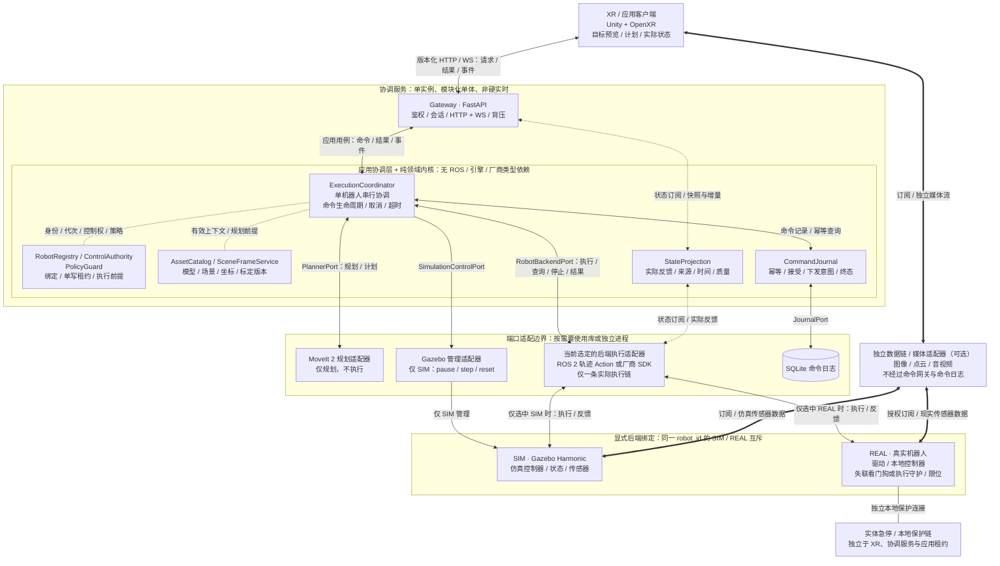

# 软件技术架构 v0.1

- 更新日期：2026-11-20
- 状态：总体架构草案；工程 / 时钟、基础类型与只读 Registry 已交付，安装与验证状态见[工程基线](06-python-foundation.md)，执行 / 停止、持久化和外部适配仍按后续任务实现
- 前置：[软件思想](01-principles-and-scope.md)
- 配套：[契约与适配器](03-contracts-and-adapters.md)、[实施与验收](04-delivery-and-validation.md)

## 技术架构总览图

以下是首条验证路径的拟议架构，不是已实现系统或实测部署图。使用支持 Mermaid 的 Markdown 预览可查看图形；不支持时可直接阅读图后的说明及后续模块表。



**读图约定：**连线表示运行时交互或连接关系，不表示源码依赖；分组是职责边界，不意味着每个方框都是网络服务。

- 普通实线表示应用请求或端口调用，双向线合并请求与返回。
- 虚线表示上下文关联或状态订阅 / 反馈；无箭头虚线不限定调用方向。
- 粗双向线合并媒体订阅与数据返回；实际传感器数据从选中且获准的 SIM / REAL 经媒体适配器流向 XR，使用独立带宽与背压预算，不承载机器人运动命令。
- REAL 与实体急停之间的无箭头实线仅表示独立本地保护连接，不是由机器人触发急停的应用调用。

### 图中的关键约束

1. **上层可迁移，下层可替换。**复用能力、目标、任务流程和公共契约；通过适配器、模型、配置与标定适应设备差异。适配器实现端口，内核不反向导入 ROS / SDK 类型。
2. **规划与执行分离。**MoveIt 只返回计划；持久化接受记录和下发意图，并在下发前复核上下文后，才通过 RobotBackendPort 执行。图中的 ROS 2 与 SDK 是替代策略，不是两个并行下发者。
3. **SIM / REAL 不是命令广播。**两条后端连线表示可选绑定；同一逻辑机器人一次只有一个可写后端，不自动故障转移。切换必须先确认旧后端停车，撤销租约并更新代次；SimulationControlPort 只操作 SIM。
4. **显示由反馈驱动。**实际机器人以驱动反馈为准，仿真以选中后端为准；目标预览和计划不能冒充实际状态。图像、点云等走独立数据链，首版可以不实现媒体流；Recorder 的本地关联记录职责见第 3 节。
5. **应用协调不替代设备保护。**软件 STOP 仍走授权后的高优先级应用 / 后端路径，不等于图中的实体急停。REAL 启用前须验证本地失联停车链，尤其是协调服务消失但驱动仍在线的情形；无法证明时只读。

## 1. 技术基线

| 部分 | 首选候选 | 边界与验证条件 |
| --- | --- | --- |
| 领域内核 / 应用运行时 | Python 3.12、类型标注、asyncio | 不承担硬实时；无 ROS、引擎或厂商类型依赖 |
| 网关与契约 | FastAPI、Pydantic 2、HTTP / JSON、WebSocket / JSON | HTTP 管理会话和查询，WebSocket 传命令、事件和轻量状态；导出 OpenAPI / JSON Schema |
| 机器人运行环境 | Ubuntu 24.04、ROS 2 Jazzy | 是文档基线而非永久版本要求；受驱动限制时隔离适配进程，不混装不兼容运行库 |
| 仿真 | Gazebo Harmonic、ros_gz、适用时 gz_ros2_control | 与驱动、模型、ROS 版本形成固定测试组合 |
| 机械臂规划 | MoveIt 2，经 PlannerPort 接入 | 首版使用规划结果，再由唯一执行路径下发，不同时调用两条执行链 |
| 机器人执行 | 官方 ROS 2 驱动 / ros2_control，必要时厂商 SDK 适配 | 原生 SDK 和实时控制仍在设备侧进程 |
| XR 前端 | 支持 OpenXR 的 Unity LTS、XR Interaction Toolkit、C# | 精确版本经样例验证后固定；不直接引用内核 Python 或机器人 SDK |
| 本地持久化 | SQLite 命令日志、版本化资产清单；ROS 数据使用 rosbag2 | 不引入 Redis / Kafka；图像不存进 SQLite 命令表 |
| 测试与构建 | pytest、契约测试、ROS 集成测试；前端测试工具待锁版 | 此处是技术选择，不表示依赖已安装或测试已运行 |

HTTP / WebSocket 是应用接入契约，不是重新发明机器人总线。首版不依赖 Unity ROS-TCP 的历史版本兼容性；如后续验证适合，可在前端适配层替换连接实现，而不改变领域模型。

## 2. 分层与依赖规则

| 层 | 主要内容 | 允许依赖 |
| --- | --- | --- |
| XR / 应用层 | 输入动作、目标预览、设备状态、任务 UI | 版本化公共契约，不接触硬件 SDK |
| 接入层 | 鉴权、会话、HTTP / WS、限流、消息大小限制 | 应用服务和边界类型 |
| 应用协调层 | 控制权、命令路由、规划协调、生命周期、后端切换 | 领域模型与端口 |
| 领域层 | 能力、任务、机器人状态、单位、标识、状态转换 | 语言标准库和纯领域类型 |
| 适配层 | ROS 2、MoveIt、仿真、厂商 SDK、日志和存储 | 实现领域 / 应用端口，可依赖外部库 |
| 设备 / 仿真层 | 驱动、控制器、硬件、Gazebo 等 | 各自的原生运行环境 |

外层依赖内层，内核不反向依赖适配器。组装入口读取已验证的配置，显式选择适配器。不能从不可信配置下载或执行任意 Python 插件。

## 3. 逻辑模块

以下为同一协调服务内的模块边界，不表示要拆成多个网络微服务。

| 模块 | 职责 | 不负责 |
| --- | --- | --- |
| Gateway | 鉴权、会话、协议校验、请求关联、订阅和背压 | 运动规划、硬件控制周期 |
| RobotRegistry | 逻辑机器人、真实身份、后端绑定、代次、能力和健康快照 | 自动把真机当成仿真故障转移目标 |
| ControlAuthority | 单写控制租约、到期、撤销、停止权限 | 替代硬件急停或厂商原生控制权 |
| PolicyGuard | 模式、权限、时序、状态新鲜度、范围及能力检查 | 声称软件校验获得安全认证 |
| ExecutionCoordinator | 命令生命周期、规划 / 执行协调、取消和超时 | 电机闭环、在未知执行结果时盲目重试 |
| SceneFrameService | 场景版本、坐标树、标定、变换快照和有效性 | 首版自动 SLAM、自动生成可信物理参数 |
| AssetCatalog | 模型、碰撞、惯量、工具、映射、版本和许可证清单 | 强制所有引擎采用同一种场景格式 |
| StateProjection | 归一化后端反馈，区分目标 / 规划 / 实际状态，生成快照 | 将预测值冒充测量值 |
| CommandJournal | 幂等记录、接受 / 下发意图 / 终态、查询和审计 | 保证跨网络 exactly-once 或自动重放运动 |
| Recorder | ROS 数据、事件、配置和标定版本关联 | 默认上传现实空间影像或无限保存数据 |

外部端口包括 PlannerPort、RobotBackendPort、SimulationControlPort、JournalPort。端口细节见[契约](03-contracts-and-adapters.md)。

### 有效能力不是驱动能力列表的直接转发

例如，对外的 manipulation.pose_goal 需要规划器、有效模型、坐标、策略和底层执行能力共同成立。只有关节轨迹驱动而无规划器时，不宣称支持末端目标。厂商原生任务模式可在后续作为另一执行策略接入。

## 4. 典型执行与反馈

### 4.1 离散末端目标

1. XR 根据动作生成目标预览，使用明确的 world / base 坐标，不直接发送手柄原始局部坐标。
2. 用户确认后提交命令，携带逻辑机器人、后端代次、租约、有效期、场景和标定版本。
3. 网关验证结构和身份；应用检查幂等、控制权、能力、时钟、状态和约束。
4. 命令记录持久化成功后返回 ACCEPTED；这仅表示平台接受处理，不表示已运动。
5. PlannerPort 请求 MoveIt 规划。规划产物关联模型、场景和约束版本。
6. 下发前再次检查租约、后端代次、状态和规划前提；过期则拒绝执行或重新规划。
7. 记录下发意图，RobotBackendPort 通过配置的单一路径执行轨迹；ROS 2 首版使用配置的轨迹 Action。
8. 后端回传命令关联反馈和真实状态；只有满足完成判据才报告成功。
9. XR 分别显示目标预览、计划和实际机器人状态，不用插值动画推断任务完成。

MoveIt 首版只承担该路径中的规划职责，不同时另行请求 MoveIt 执行与底层 Action 执行。控制器 Action 名称和类型由适配配置提供，不能假设所有厂商名称相同。

### 4.2 停止、取消和未知结果

- 取消先进入 CANCEL_REQUESTED；请求发出不代表电机已停止。
- 普通 STOP 使用高优先级处理路径，撤销运动租约并进入 DISARMED，不排在大量遥测之后；经授权的停止不被当前控制租约占用挡住。
- 软件超时或网络断开后，记录停止请求并阻止后续运动；若无法确认停止，标记运动状态 UNKNOWN。
- 物理停止与失联停车依赖设备侧机制。若网关进程崩溃，不能指望网关继续发送停止；必须依靠经验证的设备侧看门狗。
- 命令 FAILED / TIMED_OUT 不证明机器人已经停止；在 STOPPED 被确认前不接收下一条运动。

## 5. 资产、场景与虚实连接

### 5.1 三类版本化对象

- RobotModelPackage：机器人结构、关节命名、限位、碰撞、惯量、工具与驱动映射。首条 ROS 路径以 URDF / Xacro 为结构源，生成物与人工补充配置分别记录。
- WorldPackage：场景对象、稳定对象 ID、几何、碰撞和后端专有物理参数。SDF、USD、MJCF 可以共存，但须声明来源、转换损失和各自有效范围。
- CalibrationSet：XR 跟踪空间、工作站世界、机器人基座、工具及传感器之间的变换和不确定度。仿真标定不能直接冒充真机标定。

AssetCatalog 保管版本与清单；SceneFrameService 使用当前有效版本。修改工具、碰撞模型、基座标定或场景障碍会使旧计划失效。执行期间前提失效时，首版请求停止并锁住新运动，不暗中替换仍在执行的轨迹。

### 5.2 Real2Sim 的首版含义

1. 人工建立或导入工作站场景，对现实对象分配 ID。
2. 显式标定机器人、场景与 XR 空间。
3. 驱动反馈更新虚拟机器人；传感器可作为独立可视化数据源。
4. 显示数据来源、时效和不确定性；没有观测到的对象不宣称已同步。

这是一条可验证的状态映射路径，不等于自动重建现实世界。首版静态场景也不能感知突然进入工作区的人或物。

### 5.3 Sim2Real 的首版含义

复用任务代码和目标语义，在真机上重新绑定能力、模型、坐标、约束和执行器。仿真验证通过是进入真机评估的条件之一，不是物理正确性或安全性的证明。不得直接重放仿真产生的关节轨迹到未知真机。

## 6. 运行时、并发与数据

### 单个逻辑机器人的串行协调器

每台逻辑机器人使用独立的串行协调器处理状态转换。同一时刻只允许一个离散运动任务；首版不提供隐式运动队列。规划任务也占用该任务槽，避免在多个旧目标之间排队。

- 网络接入、ROS executor 和记录器通过有界队列或线程安全桥与协调器通信。
- 阻塞 SDK、规划请求和磁盘操作不得卡住接入事件循环；采用独立线程 / 进程并设置超时。
- ROS 回调只做转换和投递，不在回调线程直接修改领域状态。
- 高优先级停止、控制权事件与普通状态队列分离；状态可合并为最新值，命令终态不可静默丢弃。
- 优先级不等于硬实时保证；记录停止处理时延，超过预算就禁止 REAL 激活。

### 数据路径

| 数据 | 主要路径 | 保留 / 背压策略 |
| --- | --- | --- |
| 命令、控制权、切换 | Gateway → 协调器 → 后端 | 有界、可拒绝、不自动重放 |
| 命令事件 | 协调器 → Journal → Gateway | 持久化关键事件；慢客户端断开后通过查询恢复 |
| 轻量机器人状态 | 后端 → StateProjection → WS | 最新值优先；序号、时间和质量标识 |
| 图像、点云、音视频 | 原生 ROS 数据链或独立媒体适配器 | 设独立带宽预算；压缩 / WebRTC 按需求验证，首版不是前置依赖 |
| 配置、资产和标定 | 版本化文件 + AssetCatalog | 读写权限分离；运动时不热替换关键配置 |

首版可先只显示机器人模型和轻量状态，不为了实现大媒体链阻塞控制验证。数据回放只能进入隔离的回放 / 仿真会话，不具有真机命令权限。

### 命令日志与崩溃恢复

SQLite 记录幂等键、请求摘要、后端代次、接受结果、下发意图、后端句柄和终态。关键记录失败时不继续下发新运动；停止走可用的本地路径，不因审计磁盘已满而被阻塞。

数据库写入与外部机器人命令不是一个原子事务。写入下发意图后崩溃，既可能尚未发送，也可能已经执行。因此重启后：

1. 新建运行时与后端代次，撤销旧会话和租约，默认 DISARMED。
2. 对未结命令进行状态查询 / 对账；不能确认的保持结果未知。
3. 不恢复运动队列，不重放命令，不因日志里显示失败就解锁。
4. 确认设备身份、当前状态、控制权和停止状态后，再经显式操作激活。

## 7. 后端绑定与切换

逻辑 robot_id 与真实 device_id 分离。设备身份须在连接时核对；同一物理设备不能被两个可写逻辑机器人重复注册。允许只读镜像，但镜像不持有执行端口。

SIM / REAL 是后端属性，不允许前端在普通运动包里随意修改。切换由有权限的操作者执行：

1. 冻结新命令，通知当前控制者，请求停止 / 取消当前任务。
2. 取得旧后端停止确认；无法确认时保持冻结，不把切换当作逃避未知运动的手段。
3. 撤销旧租约，结束旧绑定，生成新的 backend_epoch，使在途旧命令失效。
4. 连接目标后端，核对设备身份、能力、模型、工具、场景、标定及本地保护配置。
5. 新绑定先只读且 DISARMED；操作者确认 SIM / REAL 与设备，再申请新控制权并激活。
6. 任一步失败均留在冻结 / 未激活状态；不自动切回可能运动的旧设备。

仿真 reset、时钟回退、关键模型 / 标定替换，以及协调服务冷启动，也必须使旧绑定上下文失效。上层任务流程可以复用，但必须构造新上下文中的命令，不能原包重发。

## 8. 部署边界

### 开发 / 仿真

- Linux 主机：协调服务、ROS 2 驱动适配、MoveIt、Gazebo。可以先使用普通测试客户端，不依赖头显。
- Windows 或兼容的 XR 主机：Unity / OpenXR，仅连接网关和获准的数据流。
- 两端可以跨主机部署；Linux 与 Windows 的版本组合、时钟估算、防火墙和网络时延须实测，不默认 WSL 满足硬件实时或 USB / 网络需求。进程隔离也不保证不同 ROS 发行版自动互通，跨版本边界必须有明确且经过测试的协议。

### 真机

- 协调服务与机器人驱动部署在受控本地网络，时间敏感组件尽量靠近设备。
- 驱动 / 控制器承担本地控制周期、失联处理和最终限位；急停链独立于 XR、网关和普通局域网。
- 协调服务首版单实例；同机进程锁防误启动，设备支持时同时使用厂商控制权机制。跨主机双写不能靠一个 Python 锁解决，首版禁止这种部署。
- 后端代次是应用级防陈旧标识，不自动成为厂商控制器的 fencing token；切换前仍须确认旧执行者失效。
- 轨迹 Action 客户端退出不保证自动取消；协调服务消失但驱动仍在线时，厂商通信看门狗也可能不触发。REAL 必须验证从应用控制权失活到本地停车的完整链路，必要时在机器人侧适配进程中加入独立执行守护。无法证明该链路时仅开放只读。
- 示教器、厂商控制台或其他 ROS 节点可能绕过网关。接入验收必须核对原生控制模式、访问权限和独占条件，不能仅凭网关租约声称物理单写。
- 计划停机先禁用新运动、请求停止并确认；强制结束进程不能视为停车方法。

## 9. 安全与权限边界

- 开发默认绑定回环地址；跨主机使用受控网络和加密的 HTTPS / WSS，认证凭据由部署环境注入。
- 至少区分 viewer、operator、administrator：只读、申请控制 / 发任务、配置 / 切换；STOP 可授予独立权限。
- 校验 WebSocket 来源、身份、会话和消息大小。租约 ID 不代替身份认证，不写入共享日志。
- ROS 2 图不直接暴露为公共接口。ROS_DOMAIN_ID 只用于隔离发现域，不是访问控制；按威胁模型配置网络隔离和 DDS / SROS 2 安全能力。
- 不提供任意 ROS topic 发布、任意 SDK 调用、脚本执行或文件路径透传的公共调试接口。
- 日志默认本地保存，脱敏凭据，设定保留周期；现实环境图像 / 人体数据不默认上传外部服务。
- 应用权限、软件 STOP、轨迹碰撞检查均不等于功能安全认证，也不替代现场风险评估。

## 10. 可观测性

每条命令串联 request_id、command_id、robot_id、backend_epoch、模型 / 场景版本和后端句柄。事件流有序号，重新订阅后先读取快照再对账，不把 WebSocket 连接本身当作持久队列。

最低观测项包括：

- 命令接受、规划、下发、反馈和确认停止时延，分别统计而不是合成一个“实时性”数字。
- 实际状态年龄、时钟估算不确定度、队列深度、丢弃 / 合并的状态数量。
- 当前租约、激活状态、后端健康、设备身份和能力版本。
- 拒绝原因、版本不匹配、未知执行结果、失联与重连次数。

进程存活不等于机器人就绪；health、readiness 和允许运动条件分别暴露。监控标签不得包含凭据或无限增长的请求正文。

## 11. 建议代码组织（按阶段创建）

```text
src/framework/
  domain/                 # 纯领域类型、能力、状态与规则
  application/            # 用例、控制权、命令协调、场景管理
  ports/                  # 后端、规划、日志等抽象
  adapters/
    ros2/                 # 驱动 / Action / 消息转换
    moveit/               # 规划适配，不重复执行
    gazebo/               # 仿真管理能力
    persistence/          # SQLite 与本地资产
  gateway/                # HTTP / WS、认证、边界 DTO
  bootstrap/              # 配置加载、依赖组装、进程入口
interfaces/schemas/       # 版本化公共契约与测试样例
ros_ws/src/               # 必需的 ROS 包与 launch
clients/unity/            # XR、坐标边界、目标预览和反馈显示
assets/                   # 机器人 / 场景源及转换清单
profiles/                 # 不含凭据的显式后端配置
tests/                    # 单元、契约、集成、故障注入
docs/                     # 当前资料与设计
```

当前[源码](../../src/framework/)包含 domain 的时间、基础值、几何、目标、能力和只读观测，application 的读取端口与 Registry，以及时钟 / 只读 mock 适配；端口位于 application/ports.py，不为建议树补齐独立空目录。安装 / 实测范围见[工程基线](06-python-foundation.md)。

内核使用普通领域类型；Pydantic 模型位于边界，不让 HTTP DTO、ROS 消息和 ORM 模型成为同一个类。实现首阶段只创建必要目录，不为了填满此树生成空壳模块。

## 12. 暂缓的扩展

多实例高可用、多机器人协同任务、连续遥操作、力反馈、移动导航、跨形态技能重定向、在线场景重建与学习策略迁移，均需要独立契约和验收。现阶段保留能力族与适配端口，不宣称已支持上述功能。
